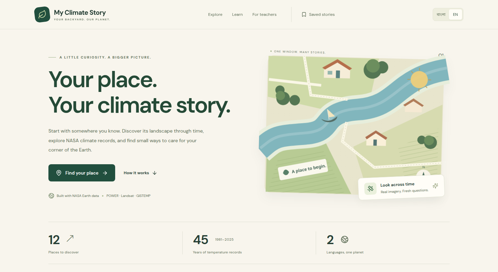
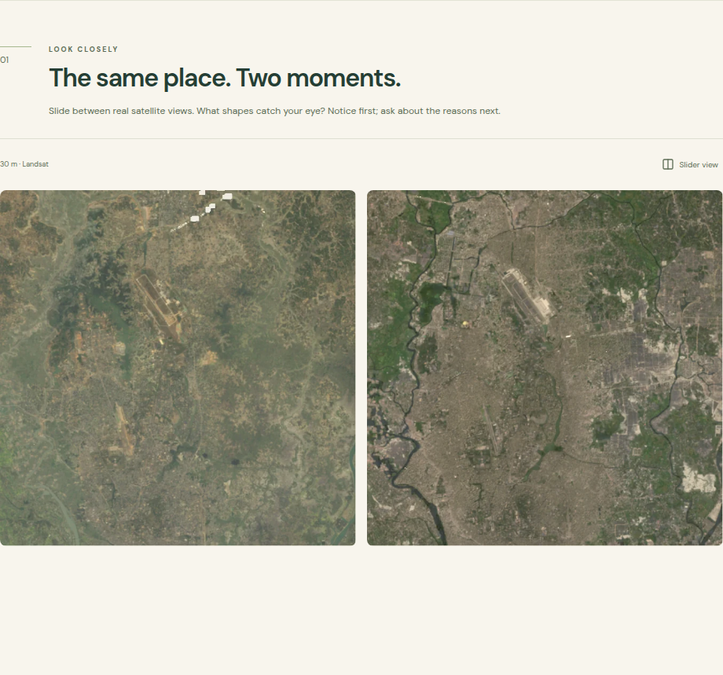
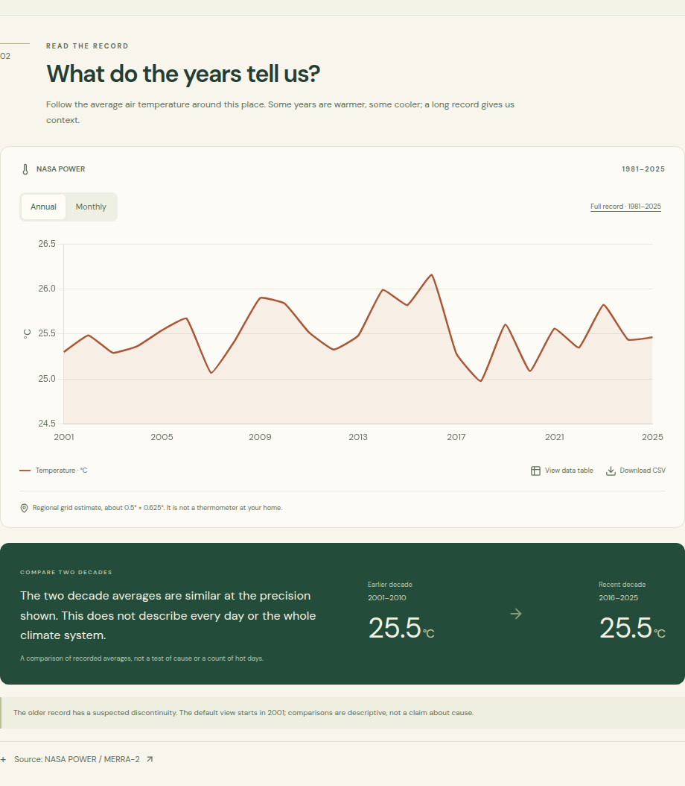
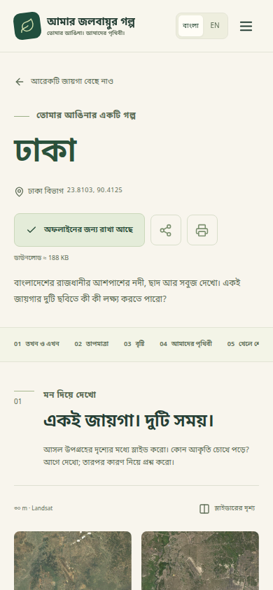
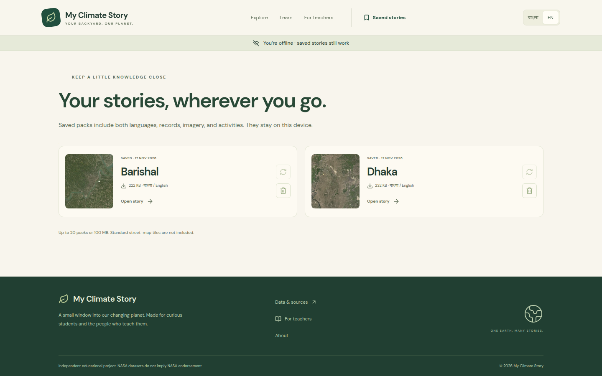
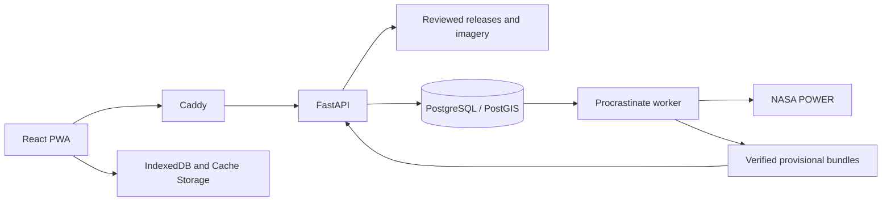

<div align="center">


# My Climate Story

**আমার জলবায়ুর গল্প**

### Climate learning starts with a place you know.

A Bangla-first educational PWA that turns NASA Earth data into familiar stories for students in grades 6–10. Explore a place, compare its landscape, read the climate record, and keep learning offline.

[**Open the live app**](https://climate-story.hridoy.xyz) · [**Watch project video**](https://www.youtube.com/watch?v=RKUiUpAazwo) · [বাংলা](https://climate-story.hridoy.xyz/bn/) · [English](https://climate-story.hridoy.xyz/en/) · [Read the docs](docs/README.md)

[](https://github.com/kawsher-hridoy/my-climate-story/actions/workflows/ci.yml)


Built for the [2026 NASA International Space Apps Challenge](https://www.spaceappschallenge.org/2026/).

</div>

[](https://climate-story.hridoy.xyz/en/)

<p align="center"><sub>Real application screenshots, captured from the local production PWA build.</sub></p>

[Overview](#overview) · [Project video](#project-video) · [Screenshots](#screenshots) · [Engineering](#engineering) · [Quick start](#quick-start) · [Data & scope](#data--scope) · [Documentation](#documentation)

## Overview

Climate education is easier to connect with when it starts close to home. My Climate Story brings together familiar Bangladesh locations, real satellite observations, readable records, bilingual activities, and a classroom-friendly narrative—not just a statistical dashboard.

| Curated places | Temperature history | Reviewed Landsat images | Languages |
|:---:|:---:|:---:|:---:|
| **12** across Bangladesh | **45 years** · 1981–2025 | **24** images · 12 pairs | **বাংলা + English** |

**The learning journey:** choose a place → look across time → read the record → play a quiz → choose an action → save the story.

| Experience | What students can do |
|---|---|
| **Explore a familiar place** | Open a curated story, search available names, or select coordinates worldwide. |
| **Look across time** | Use a keyboard-accessible slider or side-by-side view of reviewed Landsat images with real acquisition dates. |
| **Read the evidence** | Switch between annual/monthly temperature views, inspect tables, download CSV, and explore separate global context. |
| **Learn by doing** | Play five-question bilingual activities and choose relevant student, family, or school actions. |
| **Keep the story** | Save both languages, records, sources, quizzes, and owned imagery; reopen them without a connection. |
| **Bring it to class** | Print a story and use the teacher guide without creating student accounts. |

**Current limits:** verified IMERG rainfall measurements are pending. Newly retrieved global temperature is provisional; arbitrary global points do not automatically receive approved image pairs or change comparisons. See [data and scope](#data--scope).

## Project video

Watch the project presentation, published as **Be An Earth System Trend Detective! — Team: Delta Detectives**.

<p align="center">
  <a href="https://www.youtube.com/watch?v=RKUiUpAazwo">
    
  </a>
  <br>
  <a href="https://www.youtube.com/watch?v=RKUiUpAazwo"><strong>Watch the project video on YouTube ↗</strong></a>
</p>

## Screenshots

These captures show the implemented interface using reviewed curated data. Click the images to view them at full size.

| Then & now | Reading the record |
|---|---|
| [](docs/assets/screenshots/landsat-comparison.png) | [](docs/assets/screenshots/temperature-records.png) |
| Real images of the same area, with acquisition dates and sensor, haze, and masking caveats. | Prepared observations, accessible controls, and descriptive comparisons grounded in the source data. |

<details>
<summary><strong>See Bangla on mobile and saved stories working offline</strong></summary>

### Bangla at mobile width

The Dhaka story at a 390 px viewport, with the Bangla interface and self-hosted Bengali font.

<p align="center">
  <a href="docs/assets/screenshots/bangla-mobile.png"></a>
</p>

### Offline is part of the experience

Dhaka and Barishal saved through the app, then opened on the Saved page with the browser network disconnected. Both packs retained their languages and checksum-verified images; a release-pinned story also reopened after an offline reload.

[](docs/assets/screenshots/offline-saved-stories.png)

</details>

## Engineering

The student experience is simple; the data and persistence boundaries are deliberately explicit.

| Design decision | Why it matters |
|---|---|
| **Prepared, immutable releases** | Curated stories load versioned JSON and owned images, rather than retrieving decades of NASA data on every visit. Validation checks source agreement before publication. |
| **Durable background retrieval** | Exploration jobs and queue entries commit together. Leases, bounded recovery, and generation fencing prevent stranded work and stale-worker publication. |
| **Integrity-aware offline packs** | Bilingual manifests live in IndexedDB; saved media has a persistent cache, checksum checks, migration/repair, and reference-aware deletion. |
| **Reviewed scientific interpretation** | Calendar-aware calculations and source-bound reviews keep local temperature, global anomalies, and qualitative imagery distinct. Narration is deterministic, not a runtime AI-generated claim. |
| **One-origin deployment** | Caddy serves the frontend and proxies API/media on one EC2 host. API/database ports stay private, and student progress stays on the device. |



| Layer | Stack |
|---|---|
| **Frontend** | React 19 · TypeScript · Vite · React Router · TanStack Query · i18next |
| **Maps, charts, offline** | Leaflet · Chart.js · Dexie · Workbox |
| **API, persistence, jobs** | FastAPI · Pydantic · SQLAlchemy · Alembic · PostgreSQL 17/PostGIS · Procrastinate |
| **Scientific processing** | Python · NumPy/pandas · rasterio · xarray · checksum-bound review records |
| **Deployment** | Docker Compose · Caddy · AWS EC2 |

The complete live application runs on one EC2 instance. Its small-instance configuration is a pilot, not a sustained classroom-load guarantee. See [architecture](docs/architecture.md), [offline storage](docs/offline.md), and [EC2 deployment](docs/aws-deployment.md) for details.

## Quick start

Requires Docker Engine and Docker Compose. From the repository root:

```bash
git clone https://github.com/kawsher-hridoy/my-climate-story.git
cd my-climate-story
cp -n .env.example .env
docker compose --env-file .env -f infra/compose.yml up -d --build --wait
```

Open **[localhost:8088/bn/](http://localhost:8088/bn/)** or **[localhost:8088/en/](http://localhost:8088/en/)**. The reviewed snapshot ships with the repository; student use does not require Earthdata credentials.

Stop the local stack without deleting containers or data:

```bash
docker compose --env-file .env -f infra/compose.yml stop
```

The example credentials are for local development only. Follow the [deployment guide](docs/deployment.md) before exposing a server.

<details>
<summary><strong>Native development</strong> · Python 3.12 and Node 24</summary>

Use the locked `uv` and npm environments. Node 22.12+ is also supported locally.

```bash
cp -n .env.example .env
uv sync --locked --extra dev
npm ci
uv run python scripts/bootstrap_data.py
make db
```

Start `make api`, `make worker`, and `make web` in separate terminals. Vite serves the UI at `localhost:5173` and proxies the API at `localhost:8000`. Offline browser checks require the production build and its service worker.

See the [developer guide](docs/developer-guide.md) for configuration, CLI commands, and change workflows.

</details>

### Quality checks

[GitHub Actions](.github/workflows/ci.yml) defines separate Python/data/documentation, frontend, and disposable PostGIS integration jobs.

```bash
uv run ruff check services pipelines scripts tests
uv run pytest -q
uv run python scripts/check_docs.py
uv run climate validate
npm test
npm run typecheck
npm run build
```

The integration fixture drops its test schema: **use only a disposable PostGIS database named `climate_jobs_test`, never production**. Real-browser acceptance covers language switching, imagery, mobile layout, and offline saving/reopening. See [testing](docs/testing.md) for coverage and limits.

## Data & scope

| Source | Use and interpretation |
|---|---|
| **NASA POWER / MERRA-2** | Regional temperature, 1981–2025. Annual means weight each month by calendar days; complete-decade comparisons are descriptive, not causal attribution or significance tests. |
| **USGS/NASA Landsat** | Twelve reviewed historical/recent pairs. RGB differences are qualitative and can reflect sensors, season, haze, water levels, or human activity. |
| **NASA GISTEMP** | Separate global land–ocean anomalies against 1951–1980—not local absolute temperature. |
| **NASA IMERG** | Importer and pending-state chapter are implemented; verified measurements are not included. POWER precipitation is not substituted. |
| **GeoNames, OSM, GIBS, Natural Earth** | Place selection and map context. Standard street/satellite tiles are not packaged for offline use. |

Regional gridded data is not a thermometer at a particular home. Monthly records do not establish hot-day counts, heatwaves, forecasts, or a single cause for visible landscape differences.

The original [project brief](My_Climate_Story_NASA_Space_Apps.pdf), supplied `climate_data.zip`, raw measurements, canonical reviews, and published releases are intentionally retained for reproducibility and pinned-story compatibility. The [per-location register](docs/generated/place-data-register.md) traces every curated story to its coordinates, sources, series, images, and reviews.

## Documentation

| Looking for… | Start here |
|---|---|
| Product and classroom use | [Requirements](docs/requirements.md) · [Student guide](docs/user-guide.md) · [Teacher guide](docs/teacher-guide.md) |
| Implementation and interfaces | [Architecture](docs/architecture.md) · [API](docs/api.md) · [Developer guide](docs/developer-guide.md) |
| Data and interpretation | [Source-to-feature map](docs/data-usage.md) · [Methodology](docs/scientific-methodology.md) · [Sources and licenses](docs/sources-and-licenses.md) |
| Running and maintaining the app | [Deployment](docs/deployment.md) · [Operations](docs/operations.md) · [Security and privacy](docs/security-and-privacy.md) |

See the [full documentation index](docs/README.md), [contribution guide](CONTRIBUTING.md), [security policy](SECURITY.md), and [changelog](CHANGELOG.md).

---

Created by [@kawsher-hridoy](https://github.com/kawsher-hridoy). An independent educational project; NASA/USGS datasets and citations do not imply endorsement.
