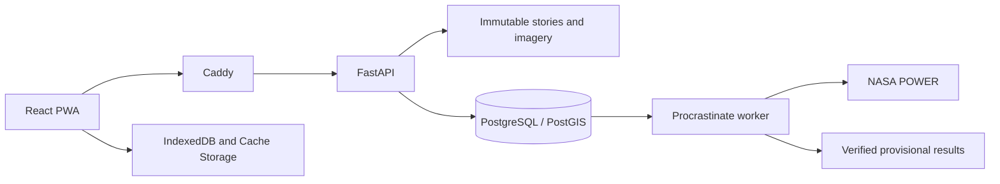

# My Climate Story · আমার জলবায়ুর গল্প

**Learn about climate through a place you know.**

A Bangla-first, bilingual educational web app for students in grades 6–10. Explore a familiar place, compare real Landsat images, read NASA temperature records, test your understanding, and choose a practical action.

Originally built for the [2026 NASA International Space Apps Challenge](https://www.spaceappschallenge.org/2026/), the project brings together a React PWA, a FastAPI backend, reproducible scientific pipelines, and an offline-first learning experience.

[**Live application**](https://climate-story.hridoy.xyz) · [বাংলা](https://climate-story.hridoy.xyz/bn/) · [English](https://climate-story.hridoy.xyz/en/) · [Documentation](docs/README.md)

[](https://github.com/kawsher-hridoy/my-climate-story/actions/workflows/ci.yml)

## Features

- **Place-based stories:** twelve curated Bangladesh locations, plus worldwide name and coordinate exploration.
- **Real satellite comparisons:** 24 reviewed Landsat images with acquisition dates, source metadata, and an accessible before/after viewer.
- **Climate records:** 1981–2025 regional temperature history, monthly/annual views, tables, CSV export, and reviewed descriptive decade comparisons.
- **Global context:** a separate GISTEMP anomaly chart against the 1951–1980 baseline.
- **Bilingual learning:** Bangla and English stories, a 30-question reusable bank, image questions, and student/family/school actions.
- **Offline use:** saved stories retain both languages, charts, quizzes, sources, and owned images. Progress stays on the device.
- **Classroom support:** printable stories and a teacher activity guide, without requiring student accounts.

**Rainfall measurements are pending.** The NASA IMERG importer and pending-state UI are implemented, but verified measurements are not included in this release. POWER precipitation is not substituted into the rainfall chapter. Global temperature requests remain provisional and do not receive automatically approved change claims.

## Architecture



| Layer | Technology |
|---|---|
| Frontend | React, TypeScript, Vite, React Router, TanStack Query, i18next |
| Maps and charts | Leaflet, Chart.js |
| Offline storage | Dexie, IndexedDB, Workbox |
| API and persistence | FastAPI, Pydantic, SQLAlchemy, Alembic, PostgreSQL 17/PostGIS |
| Background work | Procrastinate, with transactional dispatch and bounded recovery |
| Scientific processing | Python, NumPy/pandas, rasterio, xarray, source- and checksum-bound reviews |
| Hosting | Docker Compose and Caddy; the complete app runs on one AWS EC2 instance |

Curated pages read prepared, versioned data rather than fetching decades of NASA measurements on every page load. New global requests use a durable queue. Narration is deterministic and reviewed; there is no runtime language-model dependency.

## Run locally

Requires Docker Engine and Docker Compose. From the repository root:

```bash
cp -n .env.example .env
docker compose --env-file .env -f infra/compose.yml up -d --build --wait
```

Open [Bangla](http://localhost:8088/bn/) or [English](http://localhost:8088/en/). The shipped reviewed snapshot supplies the data and images; student use does not require Earthdata credentials.

To stop the local stack without deleting containers or data:

```bash
docker compose --env-file .env -f infra/compose.yml stop
```

The default credentials are for local development only. Follow the [deployment guide](docs/deployment.md) before exposing a server.

### Native development

Use Python 3.12 with `uv` and Node 24; Node 22.12+ is also supported locally.

```bash
cp -n .env.example .env
uv sync --locked --extra dev
npm ci
uv run python scripts/bootstrap_data.py
make db
```

Run `make api`, `make worker`, and `make web` in separate terminals. The UI is at `http://localhost:5173` and the API at `http://localhost:8000`. Production builds install the service worker used for offline testing.

## Quality checks

```bash
uv run ruff check services pipelines scripts tests
uv run pytest -q
uv run python scripts/check_docs.py
uv run climate validate
npm test
npm run typecheck
npm run build
```

[GitHub Actions](.github/workflows/ci.yml) runs Python/data checks, frontend checks, and a separate disposable PostgreSQL/PostGIS integration job. The integration fixture drops its test schema: **never point it at a production database**. See [testing](docs/testing.md) for coverage and browser acceptance scenarios.

## Repository guide

| Path | Purpose |
|---|---|
| `apps/web/` | Student interface, maps, charts, localization, and offline packs |
| `services/api/climate/` | Public API, catalog, jobs, recovery, and operator CLI |
| `pipelines/` | Acquisition, scientific calculations, imagery processing, release validation |
| `content/` | Bilingual educational content and canonical scientific review records |
| `data/` | Original source evidence, reviewed images, and versioned data snapshots |
| `infra/` | Container, proxy, and deployment configuration |
| `scripts/` | Bootstrap, backup, packaging, and documentation tools |
| `tests/` | Scientific, release-integrity, API, deployment, and recovery regressions |
| `docs/` | Product, engineering, data, classroom, and operations guides |

Start with the [application handbook](docs/complete-documentation.md), [architecture](docs/architecture.md), or the [source-to-feature map](docs/data-usage.md). The [data register](docs/generated/place-data-register.md) traces each curated story to its coordinates, source hashes, series, images, and review records.

## Scientific scope and attribution

POWER represents regional gridded conditions, not a thermometer at a specific home. Comparisons describe complete-decade dataset averages; they do not establish causal attribution, statistical significance, hot-day counts, or forecasts. Landsat comparisons are qualitative and disclose sensor, season, haze, and masking limits.

The original [project brief](My_Climate_Story_NASA_Space_Apps.pdf), supplied `climate_data.zip`, reviewed source files, and published releases are retained for reproducibility and pinned-story compatibility. See [scientific methodology](docs/scientific-methodology.md) and [sources and licenses](docs/sources-and-licenses.md).

This is an independent educational project; NASA/USGS citations do not imply endorsement.

Created by [@kawsher-hridoy](https://github.com/kawsher-hridoy). See [contributing](CONTRIBUTING.md) and the [security policy](SECURITY.md) before submitting changes or reporting a vulnerability.
