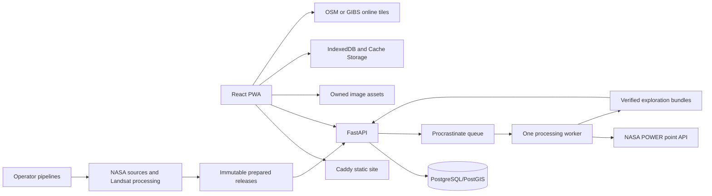
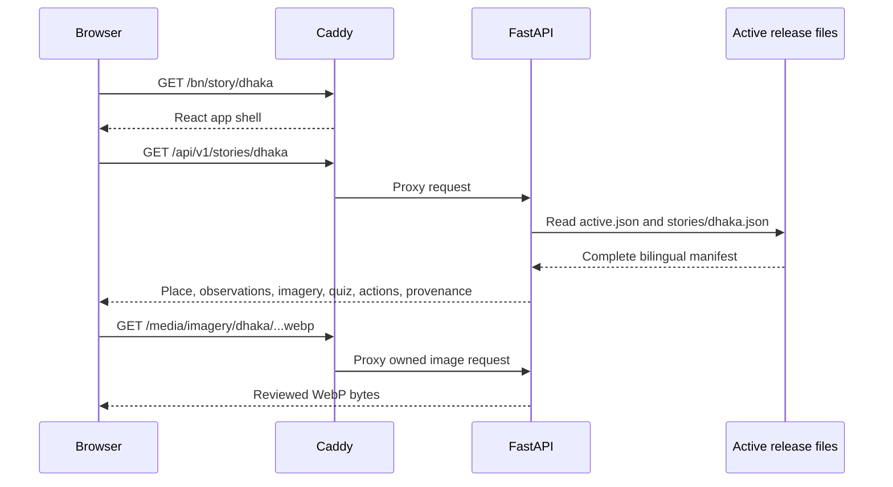
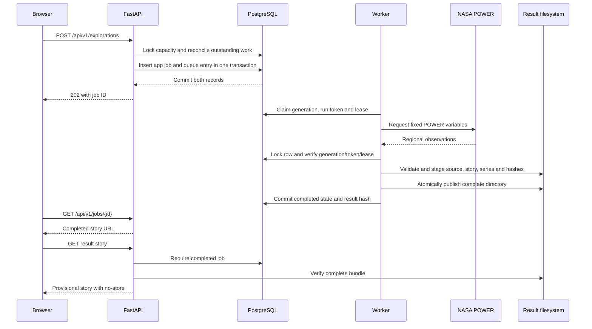
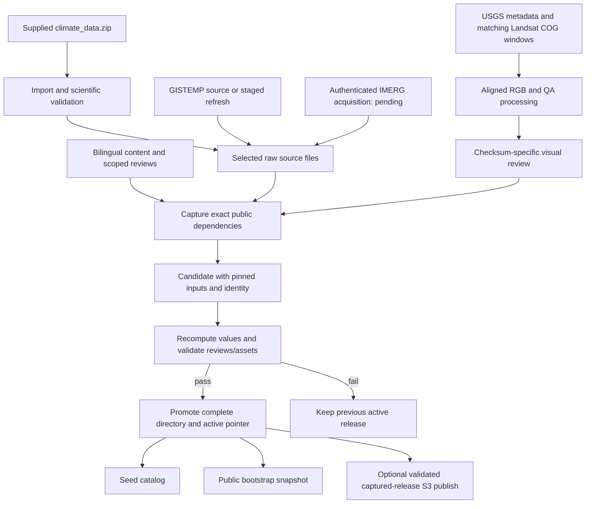

# Application architecture

This describes the implemented application, including the reliability update of 2026-11-08. Start with the [complete handbook](complete-documentation.md) for the entire system and [data usage](data-usage.md) for the source-to-screen mapping.

The browser displays prepared, versioned educational material. A Python service validates requests and runs scientific acquisition through durable jobs. Curated pages do not download raw NASA data when a student opens them.

## Deployment boundaries

Caddy serves the frontend and proxies `/api` and `/media` on one origin. FastAPI reads immutable JSON for common student requests. PostgreSQL holds searchable names, source/catalog records and durable request jobs. Procrastinate uses that same PostgreSQL instance; Redis is unnecessary.

One worker performs heavy tasks sequentially. A world-point request returns a ready story or a job reference. It cannot block the entire application while waiting on NASA.

## Releases

The active pointer references `data/processed/releases/mcs-…`. Each format 2 release contains validated stories, series, source metadata, an inventory and pinned `inputs/`. Identity includes all captured source/content/review/processing files, asset hashes, imagery policy, code hash and asset base. Effective timestamps derive from pinned acquisition/review times. New inputs create a new release; old story URLs remain usable.

Preparation writes all validated files before updating the active pointer. Refresh commands stage acquisitions and do not silently promote them. A shipped public bootstrap archive allows a clean setup to restore approved images without repeated NASA downloads.

## Local state

Saved packs, quiz answers and action choices are device-local. The server does not create student profiles. A selected coordinate is sent only for exploration, and exact coordinates are excluded from ordinary API access logs.

## Source ownership

POWER and GISTEMP are NASA sources. Landsat metadata is authoritative USGS provenance; Planetary Computer hosts matching raw assets. Published crops are owned derivatives with source IDs, QA and review records. GeoNames supplies named points rather than official administrative boundaries. Natural Earth provides only an offline overview.

See [backend](backend.md), [offline](offline.md) and [scientific methodology](scientific-methodology.md) for the policies enforced at these boundaries.

## Component responsibilities

| Component | Responsibilities | Main implementation |
|---|---|---|
| React PWA | Routes/language, story presentation, map selection, charts/tables, quizzes, saved stories | `apps/web/src/App.tsx`, `pages/`, `components/` |
| Client API adapter | Relative-origin requests, error handling, generated TypeScript contract | `apps/web/src/lib/api.ts`, `types.ts`, `api.generated.ts` |
| Local persistence | Bilingual packs, integrity/migration/repair, quiz/action progress | `apps/web/src/lib/offline.ts`, `pack-cache.ts` |
| Workbox | App-shell precache, browsing caches, saved-media priority | `apps/web/vite.config.ts` |
| Caddy | Static files, SPA routing, API/media proxy, CSP/cache headers | `infra/Caddyfile` |
| FastAPI | Request validation, prepared reads, search, exploration/polling, CSV, health | `services/api/climate/main.py`, `schemas.py` |
| Catalog | Names/aliases, source/release/series catalog, operational job state | `db.py`, `catalog.py` |
| Worker | Provisional POWER acquisition and fenced complete-bundle publication | `jobs.py`, `exploration_artifacts.py` |
| Recovery | Atomic queue dispatch, deduplication, capacity, leases and reconciliation | `exploration_lifecycle.py` |
| Operator pipelines | Source import/refresh, Landsat processing, IMERG extraction, release building/validation | `pipelines/`, `climate.cli` |

There is no runtime language-model service, Redis, student account system or server-side quiz submission. Narratives use deterministic templates and reviewed bilingual content. Operator imagery/IMERG processing is separate from an ordinary global temperature request.

## Curated story request

One story embeds local temperature, pending/available rainfall, global annual anomalies, image metadata and both languages. Charts read these arrays. Explicit series endpoints and CSV support verification/export. The default chart filters to 2001 onward; full history retains 1981–2025. Display filtering does not change saved/source data.

## Global exploration request

Final publication occurs while holding the job-row lock. Files left behind before database completion do not become served results. Older generation workers cannot overwrite the result. Prepared/completed requests can return 200 immediately; new requests return 202. Coordinates are rounded to four decimals for identity. Named requests retain the selected gazetteer snapshot.

The worker retains full POWER evidence but publishes only the temperature component. Global rainfall and historical imagery remain pending, and global comparisons are not automatically approved.

## Operator publication flow

These are operator workflows. Refreshes stage new files; selection, review, build and promotion remain separate. No recurring source-refresh scheduler is configured by default. Same-ID candidate bytes must match an existing immutable directory.

## Storage and authority

| Store | Contents | Authority/lifetime |
|---|---|---|
| Original PDF/ZIP | Requirements and supplied archive | Retained original inputs |
| `data/raw/` | POWER/GISTEMP, scene/processing metadata, gazetteer archives, optional IMERG samples | Acquisition evidence selected/pinned by a build |
| `data/staging/` | Refreshes and temporary downloads | Intermediate; not a live release |
| Release `inputs/` | Exact source/content/review inputs | Release-specific reproduction evidence |
| Release `stories/`, `series/`, `sources/`, `release.json` | Validated public outputs/provenance | Curated numerical read authority |
| `data/processed/assets/` | Owned imagery and thumbnails | Shared hash-addressed bytes |
| Exploration `bundles/` | Per-job/generation source, story, series, completion hashes | Requires matching completed DB state |
| PostgreSQL | Search/catalog, queue and job state | Operational authority; not separate climate recalculation |
| Browser IndexedDB | Saved bilingual manifests and progress | Device/origin local |
| Browser Cache Storage | Shell, browse caches, persistent saved media | Device/origin local |

The generated [database schema](generated/database-schema.md) lists actual columns and constraints. Model ID relationships are application-managed rather than declared SQL foreign keys. Source/review authority is the versioned evidence, not a manually edited database JSON row.

## Deployment and scaling boundaries

Compose runs `web`, `api`, `worker` and `db`. API/worker share host `data`; PostgreSQL/Caddy use named volumes. Native development uses a separate database on localhost:55432. Production exposes Caddy at localhost:8088; API/database ports remain private.

Caddy is fixed at `172.30.249.2`, API at `.3` on the proxy subnet. Uvicorn trusts Caddy and loopback. API also joins the database network; the worker joins the database network. One API process owns the in-memory client limiter; worker concurrency is one.

Multiple API processes require a shared limiter. Multi-host workers/releases require shared artifact storage and publication locking before adding replicas. The current filesystem/file locks assume one deployment host.

A Cloudflare quick tunnel can expose Caddy for phone testing. It uses the app's relative-origin URLs and is temporary. Packs are origin-scoped: a changed tunnel hostname creates a separate browser store.

## Caching and failures

- Curated pinned story: one-year immutable header; current curated story: short cache; global story: `no-store`.
- Verified build: 42 shell precache entries. API browse cache: 50 entries/one day. Media browse cache: 80 entries/one year.
- Saved media: separate persistent cache without application count/age eviction; final shared-reference deletion removes an asset.
- Invalid candidate: previous active pointer preserved. Failed NASA retrieval: curated stories remain available.
- Recovery: every 30 seconds, on submission and worker startup, within bounded leases/retries.
- Offline local queries run while disconnected. Missing saved media produces an incomplete/repair state.

See [backend](backend.md), [offline](offline.md), [data pipeline](data-pipeline.md), [deployment](deployment.md) and [operations](operations.md) for the exact policies.
