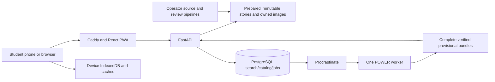

# My Climate Story: complete application handbook

Documentation baseline: 2026-11-08, implemented reliability update, active release `mcs-cbe101aec7584839`, story schema 1, release format 2, database migration `002`.

This is the starting document for understanding, running, maintaining and extending the entire app. It links to the detailed specifications rather than duplicating every source field. For the question **“which data is used where?”**, read [data usage](data-usage.md), [field dictionary](data-dictionary.md) and the [actual per-location data register](generated/place-data-register.md).

## 1. Product and accepted scope

My Climate Story teaches Bangladesh students climate concepts through a familiar place, bilingual stories, real satellite comparisons, temperature records, global context, quizzes and actions. It is based on the retained `My_Climate_Story_NASA_Space_Apps.pdf`.

Implemented: twelve curated Bangladesh places, global point/name selection, Bangla/English, actual reviewed Landsat pairs, local temperature history, scoped descriptive comparison, quizzes/actions, classroom printing, local progress and offline packs. The user accepted **rainfall marked pending** until Earthdata measurements are acquired. Global temperature is provisional; reviewed global imagery/comparisons are not automatically generated.

The [requirements](requirements.md) map every PDF area to the delivery. Accounts/classes, uploads, forecasts, daily extremes, community contributions and messaging are future scope. No runtime AI service produces scientific claims.

## 2. Architecture and implementation map



| Area | Primary location | Detailed guide |
|---|---|---|
| Routes, layout, UI, charts, quiz | `apps/web/src/` | [Frontend](frontend.md) |
| Offline save/migration/repair | `apps/web/src/lib/offline.ts`, `pack-cache.ts`, `vite.config.ts` | [Offline](offline.md) |
| API and public schemas | `services/api/climate/main.py`, `schemas.py` | [API](api.md), [dictionary](data-dictionary.md), [OpenAPI](openapi.json) |
| Database/search/catalog | `db.py`, `catalog.py`, `pipelines/gazetteer.py` | [Database](database.md), [column reference](generated/database-schema.md) |
| Durable jobs/recovery/publication | `jobs.py`, `exploration_lifecycle.py`, `exploration_artifacts.py` | [Backend](backend.md) |
| Source processing/release identity | `pipelines/` | [Data pipeline](data-pipeline.md), [methodology](scientific-methodology.md) |
| Bilingual authored content/reviews | `content/`, `apps/web/src/lib/i18n.ts` | [Content](content-and-localization.md) |
| Containers/proxy/configuration | `infra/`, `.env.example`, `scripts/start-api.sh` | [Deployment](deployment.md), [operations](operations.md) |
| Tests/evidence | `tests/`, `apps/web/src/tests/`, `output/`, `data/manifests/` | [Testing](testing.md), [verification](verification.md), [review fixes](review-fixes.md) |

The expanded [architecture guide](architecture.md) has request sequences, operator publication flow, component responsibilities, storage authority, network boundaries and scaling assumptions.

## 3. Data used by the app

| Source | Current use | Main distinction |
|---|---|---|
| NASA POWER/MERRA-2 `T2M` | 540 months/45 years of local temperature per curated place; tables, CSV and reviewed decade arithmetic | Regional gridded estimates, not house thermometers |
| Other supplied POWER fields | Unit/calendar/physical-order audit and retained provenance | No humidity/extreme-day chart; POWER rainfall is not used to fill IMERG |
| NASA GISTEMP | 146 annual global anomaly observations, 1880–2025 | Separate global baseline chart, not Bangladesh absolute temperature |
| USGS/NASA Landsat | 12 reviewed pairs/24 main images, 14 source scenes | Qualitative visual evidence with QA, sensor/season/haze caveats |
| NASA GIBS/MODIS | Online regional satellite map layer | Separate from the locally prepared historical Landsat pair |
| NASA IMERG | Importer/schema/pending chapter | Acquired measurements remain pending |
| GeoNames, OSM, Natural Earth | Names/search, online map, offline country overview | Selection/context, not local climate measurements |
| Reviewed authored content | Place descriptions, quiz options/rationales, action cards | Deterministic bilingual educational material |

The original archive contains 35,100 POWER values: 12 places × 5 variables × (540 monthly + 45 official annual values). Published local temperature uses T2M; audit retention is broader than displayed chart content. The [data catalog](data-catalog.md) records products, periods, units and source coverage.

The exact data register is generated from pinned inputs and actual story/series files. It includes every place's coordinates, story path, source SHA-256, source URL, series ID, review ID, historical/recent product/date/hash, quiz IDs and action IDs. [JSON version](generated/data-register.json) supports programmatic inspection.

## 4. Scientific processing

- Annual temperature: calendar-day weighted mean of twelve valid monthly T2M means; month 13 stays out of monthly aggregation. Curated results are checked against NASA's annual values within the rounded-input tolerance.
- Decade comparison: mean of ten complete annual values per approved window, 2001–2010 versus 2016–2025. Difference is descriptive arithmetic; display is 0.1°C. Similar rounded values receive appropriate wording.
- Rainfall: future IMERG hourly rate × 24 × calendar days; annual totals require twelve complete months. Missing is unknown. POWER rainfall is not spliced into IMERG.
- GISTEMP: separate land–ocean anomaly relative to 1951–1980; partial 2026 data does not become a complete annual observation.
- Imagery: same approximately 20 km crop and 30 m grid, surface-reflectance scaling, sensor-aware cloud/saturation masks, fixed display/gamma, current checksum-bound visual review.

See [methodology](scientific-methodology.md) for equations/limits and [imagery](imagery.md) for scene groups and exact processing. Monthly records cannot establish heatwave counts, wet-day frequency, monsoon onset or causal climate attribution.

## 5. Frontend behavior

Routes under `/bn` and `/en`: Home, Explore, curated Story, global point Story, Saved, Learn, Teachers, Sources and About. Stories have six chapters: landscape, temperature, rainfall, global context, quiz and action.

The layout localizes labels and keeps the selected place/query/hash when switching languages. Both language versions arrive in the story manifest. Map/chart modules are deferred. Temperature annual/monthly controls, tables and CSV read the embedded values. The Sources page is authored general guidance; individual story source details provide release-specific metadata.

Mobile layout includes the menu, responsive grids, large controls, self-hosted Bangla/English fonts and reduced-motion handling. The latest browser checks covered 360 px Bangla Dhaka/Barishal stories with no horizontal overflow. Phone testing uses the same relative-origin app.

## 6. Backend and API behavior

Base path: `/api/v1`. The [API reference](api.md) lists all endpoints, examples, validation, caching and errors. Generated schemas/types are the interface contract.

Curated reads use the active or explicitly selected immutable release files. Search uses normalized SQL aliases. A POST exploration accepts exactly one named place or coordinate. Prepared/completed results return 200; a new durable job returns 202 and is polled by ID.

Submission commits the app job and Procrastinate entry in one PostgreSQL transaction. Global capacity is 20, exploration throttle is five requests/minute/client, and worker concurrency is one. Generation/run-token fencing and leases prevent stale workers publishing. Recovery runs every 30 seconds, on submission and worker startup, within three dispatches and a one-hour total lifetime.

The worker validates source/series agreement, stages all result dependencies, promotes a complete directory and commits its completion hash/state. Only verified completed global results are served. Global story responses use `no-store`; pinned curated stories remain immutable. Details are in [backend](backend.md).

## 7. Database and persistence

Application tables: `places`, `place_aliases`, `data_releases`, `source_requests`, `climate_series`, `observations`, `publication_reviews`, `imagery_pairs`, `exploration_jobs`. Procrastinate owns its queue/worker tables in the same database.

SQL is the search/operational catalog. Prepared files remain the curated numerical API authority. GISTEMP stays embedded in stories rather than a separately seeded series. Global job bundles remain separate from curated observation seeding. Model relationships are managed in application code; the models do not declare SQL foreign keys. Unique observation resolution/period constraints and active-request deduplication are enforced.

See [database](database.md) for migration/seeding/retention and [generated schema](generated/database-schema.md) for every application column/type/nullability/constraint.

## 8. Offline packs and local progress

Each saved pack stores a full bilingual story, release, asset references, size, save date and media status in IndexedDB. Main/thumbnail responses live in persistent `climate-pack-media-v1`. Normal browsing has separate bounded caches.

Saving validates required image responses/checksums before committing a complete pack. Old packs migrate with integrity checking; incomplete packs show repair. Repair preserves the pinned release, Update fetches the latest, and deletion removes only assets with no remaining pack reference. Cross-tab operations use Web Locks where available.

Offline local queries run while disconnected; charts, language switching, quiz/action progress and client temperature CSV remain available. Street/satellite tile prefetch is excluded; Explore uses the offline country overview. Packs and progress are local to the browser/device/origin; they are not synchronized. A different temporary tunnel hostname has a separate store. See [offline](offline.md).

## 9. Install and run

The production path requires Docker/Compose and the supplied bootstrap artifact:

```bash
docker compose -f infra/compose.yml up -d --build --wait
```

Open http://localhost:8088. Startup restores/preserves prepared artifacts, migrates SQL, initializes the queue, seeds the active release, validates it and imports the gazetteer if absent.

For native development use Python 3.12 and Node 22.12+ (Node 24 is used by the production frontend image):

```bash
uv sync --extra dev
npm ci
uv run python scripts/bootstrap_data.py
make db
```

Run separate terminals for `make api`, `make worker` and `make web`; frontend is localhost:5173 and API localhost:8000. [Developer guide](developer-guide.md) covers file ownership, common changes and release/contracts regeneration.

Configuration comes from `.env.example`/backend environment. Compose passes database components separately and uses correctly quoted connection APIs. Earthdata credentials are needed only for operator IMERG measurements. Optional S3 and proxy/subnet settings are explained in [deployment](deployment.md). Do not include credentials in frontend builds/public artifacts.

## 10. Rebuild, review and publish data

The supplied reviewed bootstrap is the simplest clean setup. A source rebuild runs import, imagery reconciliation/acquisition, build, seed and validate. Newly changed imagery must be visually reviewed; changed source comparisons need a matching scoped review.

```bash
uv run climate ingest
uv run climate imagery
uv run climate build
uv run climate seed
uv run climate validate
uv run python scripts/pack_data.py
uv run python scripts/generate_documentation.py
```

`climate build` requires twelve approved pairs for an activated release and validates the complete candidate before changing the pointer. Draft builds can remain unpublished. Refresh commands stage inputs; they are not automatic source promotion. `climate publish` validates a captured release, excludes pinned raw files from public S3 objects, and writes its captured pointer last. No S3 bucket is configured for the current delivery.

[Data pipeline](data-pipeline.md) covers exact commands, review requirements, IMERG extraction, gazetteer import and distribution. The [data dictionary](data-dictionary.md) explains release versus story versions and hash meanings.

## 11. Deployment and operations

Caddy is the one public origin; `/api` and `/media` reach FastAPI, other routes serve the SPA. SQL/API ports remain private. The dedicated proxy network pins Caddy/API to distinct addresses and limits trusted forwarded headers. Runtime data and SQL/Caddy volumes persist across application replacement.

The running app is local; an explicitly started Cloudflare quick tunnel provides temporary phone access. Permanent hosting/domain/HTTPS setup is documented but not claimed deployed. The quick-tunnel URL is not hardcoded into the app or this handbook.

Back up PostgreSQL and matching data artifacts, keep the previous release/image, and restore-test separately. Rollbacks must keep image/release format compatibility. [Operations](operations.md) covers health, source refresh, worker recovery, backups and rollback; [troubleshooting](troubleshooting.md) covers common errors.

## 12. Privacy, security and licenses

Student accounts are absent; quiz/action progress stays on the device. Global exploration coordinates are sent to the backend/POWER and retained in job/result evidence. Public result URLs have no per-user authorization and should not be treated as private storage. Ordinary API access logging is disabled; this does not erase required source/job provenance. See [privacy and security](security-and-privacy.md) for data movement, storage, boundaries and operational retention.

The project is independent; source citations do not imply NASA endorsement. Scientific sources, GeoNames/OSM/Natural Earth, fonts/icons and educational citations are listed in [sources and licenses](sources-and-licenses.md). Original vector decoration is not satellite evidence.

## 13. Verification and accepted limitations

Verified implementation: 67 Python tests including disposable PostgreSQL/PostGIS integration, 17 frontend tests, typecheck/lint/builds, zero reported npm audit vulnerabilities, actual release recomputation, all twelve API stories/series, 24 image hashes/MIME, a live global job, offline navigation/migration/media and mobile Bangla/quiz behavior.

See [verification](verification.md) and [fix report](review-fixes.md) for evidence and practical limits. Authenticated IMERG measurements are pending by explicit user decision; no rainfall values are fabricated. Daily extremes, forecasts, quantified land-cover changes and automatic global review are not part of the delivered scientific scope.

## 14. Maintaining the documentation

After changing public API models, regenerate OpenAPI/TypeScript. After changing a data release or SQL models, regenerate the exact data/schema references:

```bash
uv run climate openapi
npm run generate:api -w apps/web
uv run python scripts/generate_documentation.py
```

Review [data usage](data-usage.md) whenever a feature uses a new source/field; update the relevant architecture, science, privacy, operations and acceptance guides. Generated references write only `docs/generated/` and do not acquire measurements or alter production data. The full [documentation index](README.md) lists the specialist guides.
