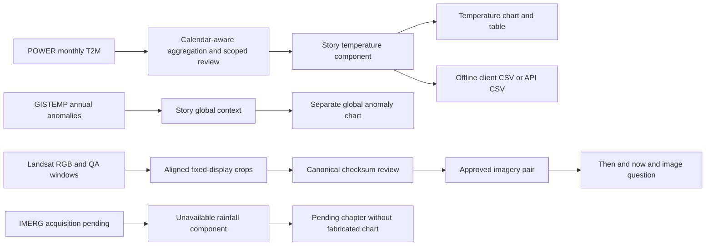

# Which data is used where

This is the source-to-feature map for the implemented app. The active snapshot is `mcs-cbe101aec7584839` (release format 2). The generated [per-place register](generated/place-data-register.md) and [JSON register](generated/data-register.json) contain exact current IDs, file paths, URLs, hashes, dates, selected coordinates, review records, quiz IDs and action IDs for all twelve places.

## Dataset and variable mapping

| Source / variable | Raw input | Transformation | Published field / UI use | Current status |
|---|---|---|---|---|
| POWER `T2M` | `data/raw/power/{place}.json`, `properties.parameter.T2M` | Remove annual month 13 from monthly array; derive calendar-day-weighted annual means; scoped complete-decade comparison | `story.temperature.monthly`, `.annual`, `.comparison`; Temperature chapter, table, CSV and explanatory copy | Available; reviewed descriptive comparisons for all 12 |
| POWER `T2M_MAX` | Same JSON, `properties.parameter.T2M_MAX` | Unit and physical-order checks | Source audit; check `T2M_MIN <= T2M <= T2M_MAX`; not a separate public chart or hot-day count | Preserved/validated |
| POWER `T2M_MIN` | Same JSON, `properties.parameter.T2M_MIN` | Unit and physical-order checks | Source audit; not a separate public chart | Preserved/validated |
| POWER `RH2M` | Same JSON, `properties.parameter.RH2M` | Validate % unit and 0–100 range | Source audit; no humidity chapter/chart | Preserved/validated |
| POWER `PRECTOTCORR` | Same JSON, `properties.parameter.PRECTOTCORR` | Validate mm/day unit and nonnegative rate | Source audit; not used to fill the Rainfall chapter because of its documented discontinuity | Preserved; excluded from rainfall-change copy |
| GPM IMERG `Grid/precipitation` | Future authenticated monthly HDF5; `data/raw/imerg/point-samples/{YYYY-MM}.json` | Nearest point sample on native 0.1° grid; mm/hr × 24 × month days; sum 12 complete months | Future `story.rainfall.monthly`/`.annual`; annual rainfall bars and table | Measurements pending; empty arrays now |
| GISTEMP annual anomaly | `data/raw/gistemp/Global_Temperature_Annual_Clean.csv`; checked against supplied original CSV | Parse complete 1880–2025 annual anomalies against 1951–1980 reference | `story.global_context.annual`; shared-planet line chart and table | 146 annual values, same context for every story |
| GISTEMP monthly derivative | `data/raw/gistemp/Global_Temperature_Monthly_Clean.csv` | Retained input/provenance | Not displayed as a monthly global chart | 1,752 retained rows |
| Landsat 5 TM / Landsat 8 OLI RGB and QA | USGS item metadata + matching Planetary Computer COG windows | Same approximately 20 km crop, 30 m alignment, reflectance transform, masks, fixed gamma and visual review | `story.imagery.before/after`; Then & now slider, side-by-side, image quiz, homepage preview | 24 approved main images, 12 pairs |
| NASA GIBS / MODIS true color | Browser-requested WMTS tiles for selected date | Leaflet tile display | Satellite layer of Explore map only | Online regional context; not historical pair evidence |
| OSM tiles | Browser-requested `tile.openstreetmap.org` tiles | Leaflet display | Street-map layer of Explore | Online; excluded from offline packs |
| GeoNames | `data/raw/gazetteer/BD.zip`, `cities500.zip`, `admin1CodesASCII.txt` | Name normalization/aliases and named-point import into SQL | Search results and named global selection | Search index; not climate observations or official boundaries |
| Natural Earth | `data/raw/maps/natural-earth-countries.geojson`; simplified `apps/web/public/offline-world.geojson` | Simplified country overview | Offline Explore overview | Context only, not offline OSM tiles |

## Authored and operational data

| Input | Processor / store | Used by |
|---|---|---|
| `content/places.json` | Builder and SQL curated-place seeding | Featured cards, selected coordinate, place name/description, relevance tags |
| `content/question-bank.json` | `quiz_bank()` and stable seeded `activity()` | Four category-balanced reusable questions plus a fifth image question when approved |
| `content/actions.json` | Tag/audience matching in builder | Four action cards including student, family and school audiences |
| `content/temperature-reviews.json` | Source-hash/window binding | Whether descriptive decade comparison can appear and its review ID |
| `content/imagery-candidates.json` | Scene selection and processing-policy reconciliation | Exact historical/recent source candidates per location |
| `content/imagery-reviews.json` | Checksum/policy/candidate binding | Approval to display the full image pair |
| `apps/web/src/lib/i18n.ts` | i18next | UI labels and bilingual educational/static pages; no NASA measurement generation |
| `data/raw/archive-inventory.json` | Archive importer; pinned by release builder | Archive hash, import time, per-source counts/hashes and serialized source provenance |
| `data/processed/active.json` | Atomic release activation | Default/current curated release selection |
| `release.json` | Validated build | Identity, dependency hashes, periods, approval counts, source requests and release API |
| SQL `exploration_jobs` and `procrastinate_*` | Transactional submission and worker/recovery | Pending/running/completed/failed progress; never treated as climate observations |
| Browser `packs` | IndexedDB | Saved bilingual story/release/assets, byte count, completion/repair status |
| Browser `progress` | IndexedDB | Quiz answers, current question, completion and selected action IDs |
| `localStorage['climate-locale']` | Shared layout | Device language preference |

The reusable bank has 30 authored bilingual questions. Each curated activity has five questions; the image question is derived from that place's approved historical date. The builder remaps the correct index after stable option shuffling. Image/temperature data never comes from an illustration or language model.

## Source-to-screen flows



## Page-by-page map

All routes are below `/bn` or `/en`.

| Page | Data read | Endpoint / local read | Presentation |
|---|---|---|---|
| Home `/` | Active curated places; recent reviewed thumbnail previews; authored introduction | `GET /api/v1/places/featured`; UI dictionary | Twelve place cards and original decorative landscape |
| Explore `/explore` | Featured place points, aliases, selected coordinate, job status; online map tiles | Featured/search APIs; `POST /explorations`; `GET /jobs/{id}`; direct tile hosts | Choose a place and start/view a story |
| Curated `/story/{id}` | Complete prepared bilingual `StoryManifest` | `GET /stories/{id}` or matching saved pack | Six story chapters |
| Global `/explore/point?id=...` | Completed verified provisional story | Same story read and offline fallback | Regional temperature; explicit unreviewed comparison/imagery/rainfall limits |
| Saved `/saved` | Device `packs`, completeness and pinned release | IndexedDB + persistent Cache Storage | Open, update, repair or remove a pack |
| Learn `/learn` | Authored bilingual concepts | `Info.tsx` and i18n | Weather/climate, units, anomalies and evidence vocabulary |
| Teachers `/teachers` | Authored lesson/worksheet content | `Info.tsx` and i18n | Printable classroom guide |
| Sources `/sources` | Authored dataset explanations/attribution | `Info.tsx`; source API available separately to clients | Units, periods, citations, spatial scale and acquisition limits |
| About `/about` | Authored purpose and privacy/local storage copy | `Info.tsx` and i18n | Project identity and device-local behavior |

Within `Story.tsx`, `#landscape` uses `imagery`; `#temperature` uses `temperature`; `#rainfall` uses `rainfall`; `#global` uses `global_context`; `#quiz` uses `quiz`; and `#action` uses `actions`.

`ClimateChart.tsx` performs display filtering only. Annual temperature defaults to 2001 onward; full history reveals 1981–2025. Monthly mode shows the selected year's twelve months. GISTEMP has its own zero-reference line. A missing value is a gap/unknown, not zero. The active rainfall component is unavailable, so the app renders its pending explanation instead of the bar chart.

## Files, public endpoints and SQL

For a curated release `R` and place `P`:

```text
data/raw/power/P.json
  -> releases/R/inputs/power/P.json          exact pinned source evidence
  -> releases/R/stories/P.json              complete bilingual public story
  -> releases/R/series/{series_id}.json     exact climate component
  -> releases/R/sources/nasa-power.json     general source metadata
  -> releases/R/release.json                release identity and source requests
```

Public story/series reads use the prepared files. `climate seed` copies curated source/release/series/observation/image metadata into SQL as a catalog. It does not move the API's numerical read authority to SQL. GISTEMP is embedded in each story; it does not have its own `climate_series` row in the current seeder. SQL `publication_reviews` holds temperature comparison evidence; canonical imagery reviews remain in pinned content and imagery payloads rather than a separately seeded image-review row.

Global requests instead publish:

```text
data/processed/explorations/R/bundles/{job_id}-g{generation}/
  source.json
  story.json
  series/{story_id}-temperature.json
  series/{story_id}-rainfall-pending.json
  complete.json
```

These require the completed SQL job and matching completion hash. Global bundles are separate from the immutable curated release directory. They are not added to the curated release's twelve-place count or automatically seeded as curated observations.

The API exposes prepared `/stories`, `/series`, `/sources`, `/releases`, `/imagery/pairs` and `/exports`. It does not expose a raw-directory download endpoint. Images use `/media/imagery/{place}/...webp`. Keep a story's release ID when reading its series/export. The generic `/sources/{id}` route uses the active release; a pinned story's embedded source is the source to use for that older story.

## Worked example: Dhaka

1. `content/places.json` selects `(23.8103, 90.4125)` and bilingual name/description.
2. `data/raw/power/dhaka.json` contains five variables with 585 values each: 540 actual months plus 45 annual month-13 summaries. The 2,925 values are retained as source evidence.
3. Only the 540 `T2M` monthly values become the public local temperature series. Forty-five annual means are independently derived and checked against NASA annual values.
4. The approved comparison uses complete 2001–2010 and 2016–2025 windows and the exact Dhaka review. UI temperatures are formatted at 0.1°C; underlying JSON retains calculation precision.
5. The imagery pair is 1990-01-07 and 2025-02-08. Source IDs, image URLs and SHA-256 values are in the generated Dhaka register.
6. The rainfall component has empty arrays and `unavailable` state. POWER precipitation is not substituted into it.
7. The global chapter uses the same separate 146-year GISTEMP anomaly context as the other stories.
8. Quiz/action IDs are selected deterministically from reviewed content. Their answers and selections stay on the device.

Barishal and Bhola have identical supplied POWER observations but distinct selected coordinates, story IDs, series IDs and comparison reviews. Their Landsat crops also remain separate. `shared_series_with` records identical source values without claiming a verified common POWER cell center.

## Meaning of the hashes

| Hash / ID | Binds |
|---|---|
| Source request SHA-256 | Exact bytes of the pinned raw POWER file |
| Temperature review `data_hash` | Canonical normalized POWER data dictionary used for review |
| Series content hash | Monthly observation content; place identity also enters public series IDs |
| Image `sha256` | Main published WebP bytes |
| Release asset hashes | Declared owned image/thumbnail bytes |
| Release identity | All pinned dependencies, policy, code and asset base |
| Bundle completion hashes | Source, both series and story files for one job/generation |

These are separate identities. Identical values do not make two places interchangeable. A rewritten output checksum cannot excuse a scientific value that disagrees with pinned source data.

## Storage in offline packs

The saved manifest includes observations, source/release metadata, both languages, quiz and actions. Main/thumbnail images go into `climate-pack-media-v1`; main-image hashes are checked. Referenced thumbnails are validated as image responses and their release asset hashes are part of release integrity. OSM/GIBS tiles are not prefetched as pack contents.

The temperature CSV button creates a CSV from the embedded component using `format.ts`; this works offline. The API also supports CSV export for external clients. GISTEMP exposes a table in the UI; it is not exported through a standalone GISTEMP series endpoint.

## Refresh this documentation

After a validated data release:

```bash
uv run python scripts/generate_documentation.py
```

This writes only `docs/generated/`. It checks source hashes and story/series agreement while generating the register. It does not download new data, change the active release, expose credentials or query production SQL. The [data catalog](data-catalog.md) explains product coverage/licenses; the [dictionary](data-dictionary.md) defines each public field.
