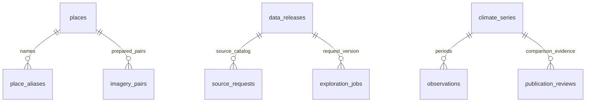

# Database and migrations

PostgreSQL 17 with PostGIS stores the searchable place index, source/catalog records and durable work. Prepared scientific payloads remain in immutable release files; the database is an index and operational catalog, not an independent recalculation source.

The generated [application schema](generated/database-schema.md) lists every column, PostgreSQL type, nullability, default, primary key, index and unique constraint. The [queue SQL](generated/queue-schema.sql) is the exact schema supplied by the locked Procrastinate dependency. Regenerate both with `uv run python scripts/generate_documentation.py`.

## Tables

| Table | Purpose |
|---|---|
| places | Curated/GeoNames IDs, names, coordinates, admin context, feature/population metadata |
| place_aliases | Normalized names linked to a place; unique place/name pairs |
| data_releases | Release manifest and status |
| source_requests | Source checksum, request coordinates, product/version and provenance |
| climate_series | Content hash, unit, publication state and prepared payload |
| observations | Unique series/period/resolution values, nullable for missing observations |
| publication_reviews | Review subject, scope/status and evidence |
| imagery_pairs | Place-specific image manifest and review status |
| exploration_jobs | Request fingerprint, release, queue ID, dispatch generation/count, lease, run token and verified result directory/hash |
| procrastinate_* | Managed worker queue schema |

The first migration creates PostGIS and pg_trgm plus search indexes. Alias substring queries use normalized text and a trigram index. A geographic point-expression index supports future spatial lookups. A named point does not represent an authoritative administrative polygon.

Migration `002` adds exploration recovery and completion fields plus the unique active-request index. It supports both an existing `001` database and a fresh installation. Older duplicate active requests are marked superseded before the index is created.

## Relationships and source identity

Story manifests map places to series/pairs. Individual source requests retain their coordinates even where numerical values are shared. Bhola and Barishal remain separate place rows and now have place-specific series IDs, so identical observations cannot overwrite coordinates or review IDs. Shared-value annotations do not assign an unverified POWER cell identity.

Observations are unique by series, period and resolution. Annual and monthly values must not overwrite each other. Source/release identities are stable; new processing/input versions create new records.

These are logical application relationships; the current models do not declare SQL foreign keys:



The seeder merges existing source/review IDs. A reused source hash or review can have its catalog release/subject updated by later seeding; immutable release files preserve historical provenance. Story manifests provide the place-to-series links. GISTEMP remains embedded in stories, while temperature/rainfall components are seeded into series/observations. Canonical image reviews remain in content/imagery payloads. Global completed bundles are not seeded as curated observation rows.

## Commands

```bash
uv run climate migrate
uv run climate queue-schema
uv run climate seed
uv run climate gazetteer
```

Seeding a release is repeatable. Gazetteer updates replace only GeoNames places and aliases, preserving curated coordinates and text. The queue schema is initialized once and checked before repeated setup.

## Backups and retention

Back up the database with PostgreSQL's custom format and preserve the matching data directory or bootstrap snapshot. Record the app image tag and active release ID alongside a backup. Test restoration into a separate database before replacing a live database.

Raw scientific provenance and approved releases should be retained. Review old operational jobs and failed acquisitions before applying a deliberate retention policy. Never delete the only approved release while an update is incomplete.
